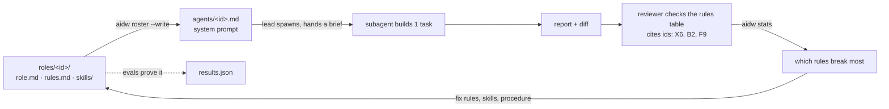

# Upgrading a Role: what it is, why, and how it is measured

This guide explains "upgrading a Role" (plan T20 onward, `docs/plans/factory-run-to-pr.md`) with a real example, the
`fullstack` Role. It is for a first-time reader and assumes no knowledge of aidw internals.

The three animated diagrams below are SVG images (open the file in a browser to see the dots move). Each also has an
interactive version made with archify in `docs/diagrams/` (pan, zoom, trace, dark and light themes): open the HTML file
in a browser.

## 1. What a Role is

In the main workflow the lead splits a Change into tasks, and each task has a `role`. To build a task, the lead spawns a
subagent (for example `aidw:fullstack`) with a fresh context and hands it a brief.

What that agent knows is decided by **one file**: `plugins/aidw/agents/<id>.md`, its system prompt. Nobody writes that
file by hand; it is generated from the Role folder:

```
plugins/aidw/roles/<id>/
  role.md      front matter (tools, access, Roles it may consult, which skills to read and when)
               + responsibility, boundaries with other Roles, order of work, report format
  rules.md     the rules table: id, rule, applies when, checked by
  skills/      detailed how-to; the agent reads one only when its condition in role.md matches
  scripts/     checks a machine can run
  evals/       cases that measure whether the agent follows all of the above
```



Interactive version: [`diagrams/role-to-agent.html`](diagrams/role-to-agent.html).



Upgrading a Role means rewriting this folder so the agent does better work, then **measuring** whether it really does.
Evals do not fix bugs in your project's code; they test the instructions themselves.

## 2. Example: `fullstack`

`fullstack` is the default implementer: a small Slice that is not split, the scaffold task, and any task with no role.
In a Slice that is not split **no `integration` task runs**, so nobody proves that the two halves (screen and server)
fit together.

**Before.** The agent writes a route test (green) and a screen test with a hand-written fake body (also green). But the
server returns `{error:{fields:{name:"taken"}}}` while the client reads `body.message`. The feature is broken and every
test is green.

**After.** The Role gained:

| Added                                       | What it says                                                                                                                                                                                                                                                                                                                                                                                        |
| ------------------------------------------- | --------------------------------------------------------------------------------------------------------------------------------------------------------------------------------------------------------------------------------------------------------------------------------------------------------------------------------------------------------------------------------------------------- |
| Rules X1 to X7 (`roles/fullstack/rules.md`) | X1 one test goes from the screen into the real handler; X2 one schema for both halves; X3 data the server hands to client code without a route (props, a loader return) is a response too; X4 a restricted page or loader checks access itself; X5 read the backend data rules when the server half is yours; X6 a server error must show in the right field on screen; X7 fresh data after a write |
| Outside-in procedure                        | write the test that crosses both halves first (it fails), build the server, build the screen, the test turns green                                                                                                                                                                                                                                                                                  |
| Skill `seam-test`                           | how to write that test per stack; MSW forwards `/api/*` to the Express app running in the same process, no socket                                                                                                                                                                                                                                                                                   |
| Skill `server-to-client-data`               | for data the server hands to the client without a route                                                                                                                                                                                                                                                                                                                                             |
| A 12-line report format                     | adds a `Seam:` line so the reviewer sees the two halves were proven to fit                                                                                                                                                                                                                                                                                                                          |



The seam test itself, step by step: [`diagrams/seam-test.html`](diagrams/seam-test.html).

## 3. Evals: proof that the agent follows the Role

Writing the instructions is not enough. Every rule, and every skill listed in the front matter, needs at least one case;
otherwise `aidw roster` reports an error (decision C1).



Interactive version: [`diagrams/eval-loop.html`](diagrams/eval-loop.html).

|             | Level 1                                           | Level 2                                                                                 |
| ----------- | ------------------------------------------------- | --------------------------------------------------------------------------------------- |
| What it is  | a scenario with a trap; the agent answers in text | a real agent session on a sample repo (`evals/fixtures/fullstack-app`)                  |
| Who grades  | another model, by the criteria in the case        | a machine: held-out tests, scripts, the tool log (`must_read`); a model grades the rest |
| It measures | what the agent **says** it will do                | what the agent **does**                                                                 |
| Cost        | low                                               | much higher                                                                             |
| To pass     | 3/3 runs (decision C2)                            | 3/3 runs                                                                                |

Result for `fullstack`: Level 1, 9 cases at 3/3; Level 2, three cases (`rename-a-project`, `invite-with-one-schema`,
`owner-only-billing`) at 3/3.

Evals also find **defects in the cases themselves**. For example the invite case failed 0/3 because a file that had to be
edited sat outside `Touches`, not because the Role was wrong. Every failure needs a cause (fix the Role, or fix the
case), and only the failed cases are re-run. Every model call for an eval is approved by the project owner first.

`results.json` stores a digest of the Role's content. If the Role changes and the cases were not re-run, `aidw roster`
warns (decision C6).

## 4. Which kinds of skill there are

| Kind                     | Example                                                                 | Who picks it                                               |
| ------------------------ | ----------------------------------------------------------------------- | ---------------------------------------------------------- |
| A Role's own skill       | `seam-test`, `server-to-client-data`                                    | the agent reads it when its condition in `role.md` matches |
| A shared skill           | `library/contract-tests`, `library/react-rules`, `library/external-api` | same; several Roles point to it                            |
| A CLI skill in the brief | `test-driven-development`, `frontend-ui-engineering`                    | `src/skills.ts` selects them from the task's `Touches`     |

## 5. Effect on the main workflow

1. **Agents build better right away.** Every `fullstack` task in a real Change now runs with the new system prompt.
2. **The reviewer has a yardstick.** The review brief of a fullstack task points at the fullstack, backend and frontend
   rules tables, so findings carry ids such as `X6: web/api/client.ts: ...`.
3. **It can be measured on real Changes.** `aidw stats` counts which rules are broken most and the first-pass rate per
   Role, so you know which rule to fix next.
4. **Accidental edits are caught.** Changing a Role without re-running its cases makes `aidw roster` warn.

Limit: evals show that the agent behaves correctly on sample scenarios. Whether real Changes get better has to be read
from `aidw stats` after a few real Changes; nobody has measured that yet.

## 6. The process for upgrading a Role (done for `fullstack`)

1. **Research** the Role's gaps in the pipeline and write them to `docs/research/<role>-role.md` (for fullstack:
   S-1 to S-12).
2. **Decision Page**: open points that belong to section 5 of the plan are put to the project owner as an HTML page with
   choices, examples and a summary to paste back, never in chat.
3. **Build** the rules, skills, procedure and report format. One implementer (Sonnet) per task in its own worktree, one
   test agent, one review agent; merge in order and run the whole test suite after each merge.
4. **Level 1 cases**, then **Level 2 cases** on a fixture; three runs per case; re-run only failed cases.
5. **Record** what was built and what the evals found in the plan. Push and merge only when the owner says so.

Order in the plan: frontend (done), backend (done), fullstack (done, PR #14), then code-reviewer, security, qa and the
remaining Roles.
